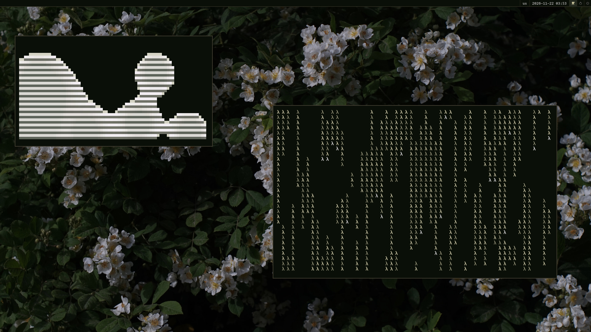
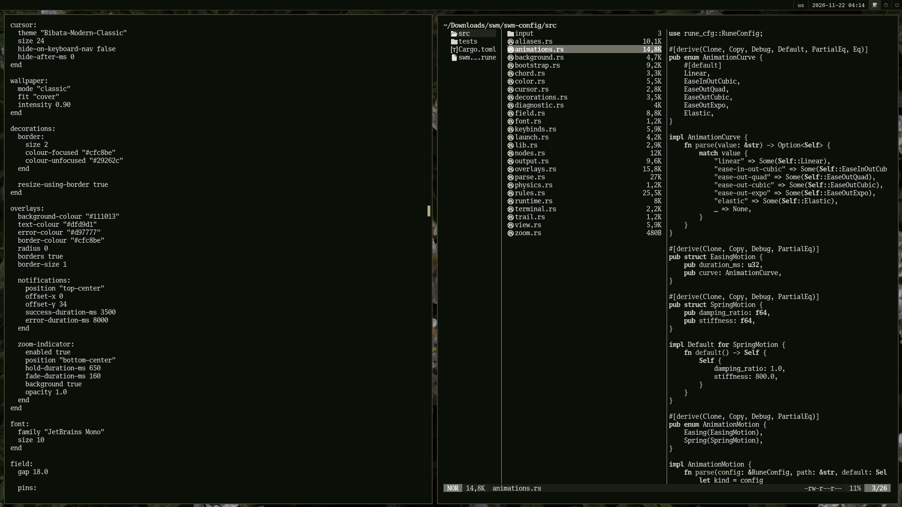

# swm

[](https://github.com/ignicat/swm/releases/latest)


**swm** (simple window manager) is a spatial Wayland window manager. Every monitor gets its own infinite 2D canvas (a **Field**), windows float wherever you drop them, and anything you don't need right now collapses into a small **Node** marker instead of getting lost on a numbered workspace.



We tried to follow the Unix philosophy: keep `swm` focused on managing windows and move the desktop extras into separate repos ([`swm-lift`](https://github.com/ignicat/swm-lift) for launching, [`swm-screenshoter`](https://github.com/ignicat/swm-screenshoter) for screenshots). It only partly worked out. A Wayland window manager also has to be the display server, so `swm` still carries the DRM/KMS and Winit backends, XWayland, server-side decorations, built-in overlays (`Alt+Tab`, zoom-to-fit, exit confirmation, ScreenCast picker), PipeWire screencasting with `xdg-desktop-portal-swm`, `swm-api` and `swmctl`. So the split is the goal, not a hard rule.

## How it works

Each monitor has its own **Field** with its own camera, focus Trail and maximize/fullscreen state. There's no tiling tree and no workspace grid: windows overlap freely and stay where you put them.

| Concept | What it does |
| --- | --- |
| **Field** | Infinite 2D canvas per monitor. Pan by dragging empty space, zoom with `Mod+-` / `Mod+=`, fit everything on screen with `Mod+O`. |
| **Node** | A running window collapsed into a clickable icon/label marker (`Mod+N`). It keeps running, stays out of screen captures, and comes back on click or `Mod+N`. |
| **Pin** | Locks a window or node to its Field position and exempts it from decay (`Mod+P`). |
| **Decay** | Opt-in (`decay.enabled`). Collapses windows that sit completely offscreen for longer than `decay.delay-seconds`. |
| **Trail** | Per-monitor focus history. Step back and forward with `Mod+,` / `Mod+.`. |
| **Zoom-to-fit** | `Mod+O` zooms each Field out to show every window and node. Click one to focus or restore it; `Esc`, `Mod+O` or a click on empty space cancels. |

## What you get

`cargo build --release --workspace` builds three binaries:

- **`swm`**: the window manager. Runs natively on a TTY (DRM/KMS, GBM, EGL, GLES) or nested in a Winit window inside an existing X11/Wayland session.
- **`swmctl`**: CLI over `swm-api` (`$XDG_RUNTIME_DIR/swm/swm.sock`) for scripting, inspecting state, moving nodes, Trail/monitor control, DPMS, config checks and portal diagnostics.
- **`xdg-desktop-portal-swm`**: `org.freedesktop.impl.portal.ScreenCast` backend, wired to the swm source picker and its PipeWire stream (GPU or MemFd buffers).

Optional companions, each in its own repo. Swap them for anything else in `swm.rune` if you prefer:

- **[swm-lift](https://github.com/ignicat/swm-lift)**: app/window/action launcher.
- **[swm-screenshoter](https://github.com/ignicat/swm-screenshoter)**: freeze-frame screenshot tool (region/screen/window/desktop) plus a Screenshot portal backend.

Without any companions installed, `Super+T` still opens the first terminal it finds (`default-terminal`).

## Requirements

- **Kernel, graphics and seat**: DRM/KMS, GBM, EGL, OpenGL ES, `udev`, `libinput`, `libseat` (`seatd` or `systemd-logind`).
- **Build**: Rust `1.97.1+`, `pkg-config`, `clang`/`libclang`, `libdisplay-info` `0.3`, `libxkbcommon`, `pipewire`, `wayland`, `systemd` libs. With the default `xwayland`/`winit` features you also need `libx11`, `libxi` and `libxkbcommon-x11`.
- **Optional at runtime**: `Xwayland`, `dbus-update-activation-environment`, `xdg-desktop-portal`, `xdg-desktop-portal-gtk` (file pickers and settings fallback).

## Build & install

See [docs/nix.md](docs/nix.md) for flakes/NixOS and [docs/packaging.md](docs/packaging.md) for system-wide `/usr` installs, init units and Cargo features (`systemd`, `dinit` or minimal TTY-only).

### Quick build (default features: `systemd`, `dbus`, `xwayland`, `winit`)

```sh
git clone https://github.com/ignicat/swm.git
cd swm
cargo build --release --locked --workspace
```

Install into `~/.local/bin/`:

```sh
install -Dm755 target/release/swm ~/.local/bin/swm
install -Dm755 target/release/swmctl ~/.local/bin/swmctl
install -Dm755 target/release/xdg-desktop-portal-swm ~/.local/bin/xdg-desktop-portal-swm
install -Dm755 packaging/wayland-sessions/swm-session ~/.local/bin/swm-session
```

Other feature sets (full matrix in [docs/packaging.md](docs/packaging.md)):

```sh
# dinit user services instead of systemd
cargo build --release --locked --workspace --no-default-features --features dbus,dinit,xwayland,winit

# Minimal TTY-only build: no dbus, no systemd/dinit, no xwayland, no winit
cargo build --release --locked -p swm --no-default-features
```

### Companions

`swm-lift` depends on `../swm/swm-api` by path, so clone it next to `swm`:

```sh
git clone https://github.com/ignicat/swm-lift.git
git clone https://github.com/ignicat/swm-screenshoter.git

(cd swm-lift && cargo build --release --locked && install -Dm755 target/release/swm-lift ~/.local/bin/swm-lift)
(cd swm-screenshoter && cargo build --release --locked && install -Dm755 target/release/swm-screenshoter ~/.local/bin/swm-screenshoter)
```

## Running

```sh
swm-session           # native session from a TTY or display manager (recommended)
swm --session         # native session without the swm-session wrapper
swm --winit           # nested window inside an existing session (Super maps to Alt by default)
swm -c /path/to.rune  # use another config (default: $XDG_CONFIG_HOME/swm/swm.rune)
swm --version         # window manager version + SWM_API_VERSION
```

Plain `swm` picks `--winit` when `WAYLAND_DISPLAY` or `DISPLAY` is set, and a native TTY session otherwise.

### Init systems & `swm-session`

`systemd` is not required. [`swm-session`](packaging/wayland-sessions/swm-session) imports your login shell environment, sets `XDG_SESSION_TYPE=wayland` and `XDG_CURRENT_DESKTOP=SWM`, then starts swm in the first way that applies:

1. An active `systemd --user` manager (`swm.service`, `Type=notify`, `graphical-session.target`), if the unit is installed for the selected binary.
2. An active `dinit` user manager ([`packaging/dinit/`](packaging/dinit/)) when `SWM_BIN=/usr/bin/swm`.
3. Otherwise a direct `exec "$SWM_BIN" --session "$@"`. This covers `runit`, `s6`, OpenRC with `elogind`/`seatd`, or a plain TTY login.

Useful overrides:

- `SWM_BIN=/path/to/swm`: use a specific binary.
- `SWM_NO_INIT_INTEGRATION=1` (or `true`/`yes`/`on`): skip `systemd` and `dinit` integration entirely. Recommended on `runit`, `s6` and OpenRC.
- The launcher logs to `$XDG_RUNTIME_DIR/swm-session.log`.

## Default keybinds

The starter bindings live in [examples/swm.rune](examples/swm.rune). A `keybinds:` block replaces the built-in defaults completely, so anything you remove there is unbound. In nested Winit mode `$var.mod` is `Alt` unless you set `mod` yourself.

| Chord | Action |
| --- | --- |
| `Super+D` | Run `swm-lift` |
| `Super+T` | Open the first installed terminal (`default-terminal`) |
| `Print` | Run `swm-screenshoter` |
| `Super+Q` | Close the focused window or node |
| `Super+Left-drag` | Move a window |
| `Left-drag` | Pan the Field (on empty space) |
| `Super+Shift+Left-drag` | Drag a window and auto-pan inside the current monitor (`drag-pan`) |
| `Super+Right-drag` | Resize a window |
| `Super+N` / `Super+P` | Collapse/restore node / pin or unpin |
| `Super+F` / `Super+M` | Fullscreen / maximize inside the Field |
| `Super+Arrow` | Focus the nearest window or node in that direction |
| `Super+Shift+Arrow` | Focus the monitor in that direction |
| `Super+Ctrl+Arrow` | Resize the focused window |
| `Alt+Tab` / `Alt+Shift+Tab` | Global recent-windows switcher |
| `Super+,` / `Super+.` / `Super+H` | Trail back / Trail forward / center the last focused window |
| `Super+O` | Toggle zoom-to-fit |
| `Super+-` / `Super+=` / `Super+Shift+0` | Zoom out / zoom in / reset zoom |
| `Super+Shift+R` / `Super+Shift+E` | Reload config / quit (with confirmation) |

Full syntax for keys, buttons, gestures and modifiers: [docs/keybinds.md](docs/keybinds.md).

## Configuration & `swmctl`



On first start without `-c`/`--config`, swm copies [examples/swm.rune](examples/swm.rune) to `$XDG_CONFIG_HOME/swm/swm.rune` (or `~/.config/swm/swm.rune`). Saving a valid edit reloads it right away; a broken edit is rejected and the last working config stays active. swm never rewrites or migrates your config file.

- Every key with its default: [examples/swm.reference.rune](examples/swm.reference.rune)
- Splitting the config into several files with `gather`: [examples/split-config/README.md](examples/split-config/README.md)

Handy `swmctl` commands:

```sh
swmctl config edit                     # open the active config in $VISUAL / $EDITOR / vi
swmctl config verify                   # parse and validate (optionally -c PATH)
swmctl reload                          # reload the active config now
swmctl outputs                         # monitors, modes, positions, scales
swmctl node list [--json]              # windows and collapsed nodes
swmctl node move right --distance 120  # move by exact Field units (or `to X Y`)
swmctl trail list                      # per-monitor focus history
swmctl dpms off eDP-1                  # turn an output off/on
swmctl portal status                   # portal backend and D-Bus wiring
```

## Security, portals & API

- **Privileged protocols are off by default.** `wlr-screencopy`, `ext-image-copy-capture`, `ext-data-control`, `zwp-virtual-keyboard-v1`, `zwp-input-method-v2` and `wlr-output-power` are denied unless you opt in with `SWM_ALLOW_SCREEN_CAPTURE`, `SWM_ALLOW_CLIPBOARD_CONTROL`, `SWM_ALLOW_VIRTUAL_KEYBOARD`, `SWM_ALLOW_INPUT_METHOD` or `SWM_ALLOW_OUTPUT_POWER`. Details: [docs/security.md](docs/security.md).
- **Portals.** [`swm-portals.conf`](packaging/xdg-desktop-portal/swm-portals.conf) routes `ScreenCast=swm;` (handled by `xdg-desktop-portal-swm`), `Screenshot=swm-screenshoter;gtk;` and `default=gtk;`. Details: [docs/portal.md](docs/portal.md).
- **API vs IPC.** [`swm-api`](docs/api.md) (`SWM_API_VERSION = 1`) is the supported Rust client crate, used by `swmctl` and `swm-lift`. `swm-ipc` (`SWM_IPC_VERSION = 2`) is the internal postcard wire format.

## Docs

- **Workspace**: [Field & zoom](docs/field.md) · [Nodes, decay & physics](docs/nodes.md) · [Zoom to fit](docs/zoom-fit.md) · [Alt+Tab](docs/alt-tab.md) · [Keybinds](docs/keybinds.md)
- **Look & rules**: [Decorations](docs/decorations.md) · [Animations](docs/animations.md) · [Custom window shaders](docs/window-shaders.md) · [Overlays](docs/overlays.md) · [Fonts](docs/fonts.md) · [Wallpaper](docs/wallpaper.md) · [Window & layer rules](docs/window-rules.md) · [Display scaling](docs/display-scale.md)
- **System & protocols**: [Autostart & logs](docs/autostart.md) · [Portals & ScreenCast](docs/portal.md) · [Wayland protocols](docs/wayland-protocols.md) · [XWayland](docs/xwayland.md) · [Output power](docs/output-power.md) · [Security grants](docs/security.md)
- **Packaging & dev**: [Packaging & init systems](docs/packaging.md) · [Nix & NixOS](docs/nix.md) · [swm API](docs/api.md) · [Architecture](docs/architecture.md) · [Testing & CI](docs/testing.md)

## License

[GPL-3.0-only](LICENSE)

---

Inspired by the `halley` window manager — `swm` took its core idea, a spatial per-monitor canvas, and built on it.
